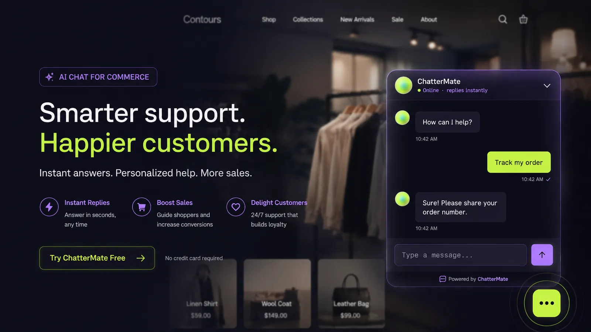
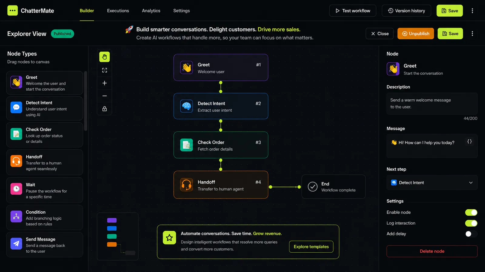
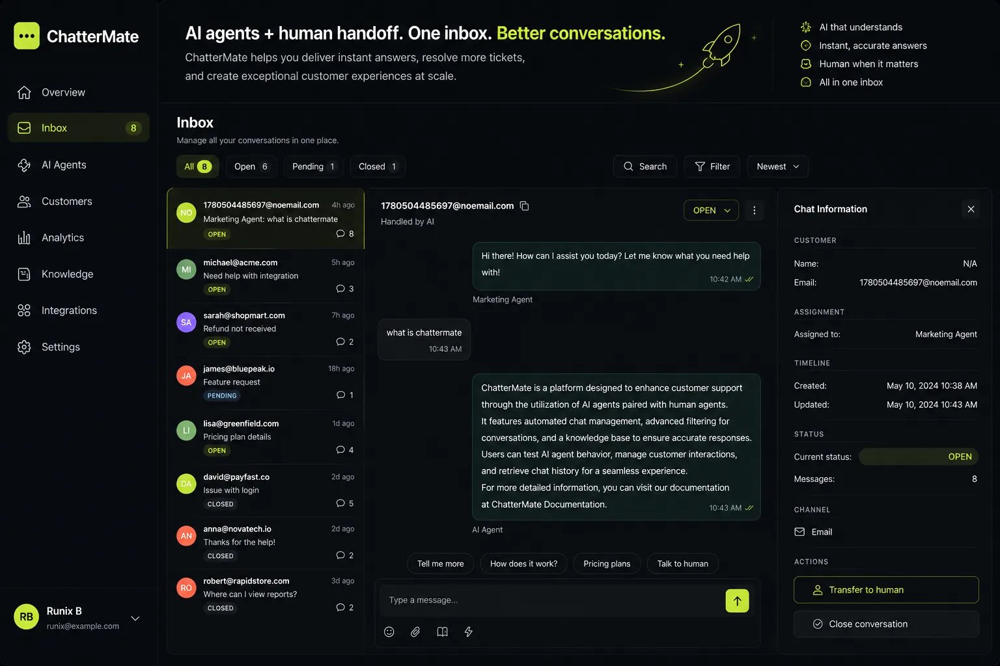
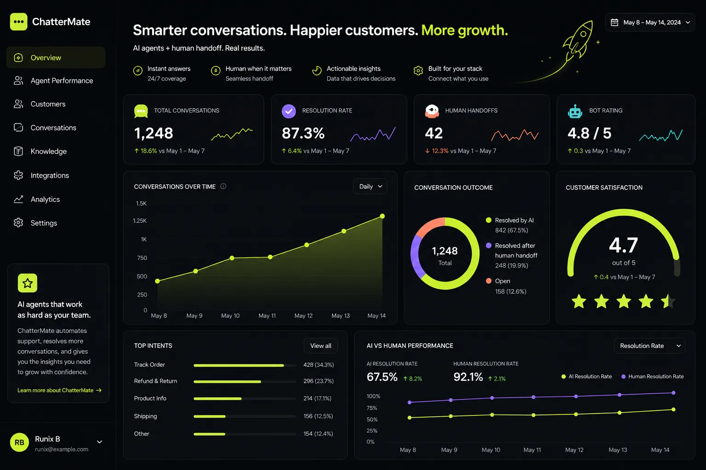

# Echo - Open Source AI Customer Support Chatbot Platform

Echo is a renamed and modified version of ChatterMate, changed on 2026-11-05. See the license files in this repository.


> **Open-source AI customer support platform with human handoff.** A no-code AI chatbot for 24/7 customer service automation — multi-model AI (OpenAI, Anthropic Claude, Google Gemini, Mistral, xAI Grok, DeepSeek, Groq), intelligent AI-to-human handover, **Shopify & e-commerce support**, Slack and Jira integrations, visual workflow builder, and a fully themeable chat widget. Use the free hosted service or self-host it as an **open-source alternative to Intercom, Zendesk, and Chatbase**.

---

## Table of Contents

- [Why Echo?](#why-echo)
- [Features](#features)
- [Integrations](#integrations)
- [Echo vs. Intercom, Zendesk & Chatbase](#echo-vs-intercom-zendesk--chatbase)
- [Demo](#demo)
- [Quick Start](#quick-start)
- [Installation](#installation-methods)
- [Deployment](#deployment)
- [FAQ](#faq)
- [Roadmap](#roadmap)
- [Contributing](#contributing)
- [Support](#support)

---

## Why Echo?

Echo is a **no-code AI customer support platform** that enables businesses to provide **24/7 customer service** through intelligent AI agents. Your AI chatbot handles common queries, escalates complex issues to human agents when needed, and continuously learns from your knowledge base. Integrate the chat widget on any website — or any **Shopify store** — with a single line of code.

**Perfect for:** e-commerce and Shopify stores, SaaS companies, help desks, customer success teams, and any business looking to automate customer support while maintaining a human touch.



---

## Features

### Core Features

| Feature | Description |
|---------|-------------|
| 🤝 **Smart Human Handoff** | Intelligent AI-to-human transfer with **business hours awareness**, real-time availability detection, and context-aware escalation messages. |
| 🛍️ **Shopify & E-commerce Support** | Native **Shopify integration** — answer order, shipping, and product questions from store data. Works for any online store. |
| 📝 **WordPress Plugin** | Official **WordPress plugin** — add the chat widget to any WordPress site by entering your Widget ID. No theme edits required. |
| 🧠 **Multi-Model AI Support** | Choose your AI provider — **OpenAI**, **Anthropic (Claude)**, **Google Gemini**, **Mistral**, **xAI (Grok)**, **DeepSeek**, and **Groq** — with your own API key, or enter a custom model ID. Switch providers anytime without code changes. |
| 💬 **Ask Anything Mode** | Let visitors start conversations instantly — no signup or email required. Perfect for Q&A, documentation assistants, and exploratory chat experiences. |
| 📎 **File Attachments** | Customers can share **images, PDFs, Word docs, spreadsheets**, and more directly in chat. Secure uploads with S3 storage and magic byte validation. |
| 🌍 **Auto Translation** | Multilingual support with configurable **default language per workflow**. Serve customers globally in their preferred language. |
| 🎫 **AI Ticketing** | Native tickets raised straight from chat, then **auto-triaged and investigated by AI** — it forms hypotheses, gathers evidence from your observability tools and databases, and writes a root-cause analysis you can read and audit. See [AI Ticketing](#ai-ticketing). |
| 🔗 **Jira Ticket Creation** | Create and manage **Jira tickets directly from chat** conversations. OAuth 2.0 secure integration with automatic ticket tracking. Native tickets can also escalate to Jira one-way. |
| 🔑 **Widget Authentication** | **Token-based security** for embedded widgets. Support both public Q&A and private authenticated conversations. |
| 💼 **Slack Integration** | Connect your **Slack workspace** for internal product support. Teams get AI-powered assistance directly in Slack channels. |
| 🧩 **Visual Workflow Builder** | Design conversation flows with a **drag-and-drop interface**. Branching logic, conditional responses, and multi-step workflows without coding. |

### Workflow Builder

Build sophisticated conversation flows visually with our intuitive workflow builder:



**Workflow Builder Features:**
- **Drag-and-drop nodes** - AI responses, human handoff, conditions, and more
- **Branching logic** - Create different paths based on user input
- **Node types** - Start, AI Response, Human Transfer, Condition, End nodes
- **Real-time preview** - Test workflows before deploying
- **Version control** - Save and restore workflow versions

### AI Ticketing

Tickets are raised from a conversation (by the AI or an agent), or from an alert
webhook. Each one is triaged, deduplicated against open tickets, and then
investigated: the AI proposes hypotheses, tests each against your connected
tools, and records every query it ran as evidence you can inspect. The result is
a versioned root-cause analysis with citations back to that evidence.

Connect read-only investigation sources under **Settings → Ticketing**:
observability platforms via MCP (Grafana, Elasticsearch, Sentry, CloudWatch, or
any MCP server), and optionally a **guardrailed SQL connector** (Postgres/MySQL,
direct or over an SSH tunnel).

**Autonomy is staged, and you choose the level:**

| Level | The AI can |
|-------|-----------|
| **L1** | Investigate and document only |
| **L2** | Also propose a resolution — a human approves or rejects it |
| **L3** | Also message the customer and close the ticket, behind confidence guards |

#### Guardrails

The investigation agent reads untrusted customer text and holds live tool
access, so the limits are enforced in code, not by prompting:

- **The SQL connector is read-only, structurally.** Queries are parsed to an AST
  and rejected unless they are a single plain `SELECT`. Writes, DDL, multiple
  statements, and a denylist of dangerous functions cannot pass. Table access is
  restricted to an allowlist you pick, enforced through CTEs, joins and
  subqueries. A `LIMIT` is forced. Comments are stripped before execution, since
  MySQL executes `/*! */`. The connection itself is a read-only transaction with
  a statement timeout — a second, independent barrier.
- **Columns you mask are never readable.** Masked columns are blocked from being
  referenced anywhere, including in a `WHERE` clause, so their values can't be
  probed; whole-row tricks that would smuggle them out (`to_jsonb(t)`, `t::text`,
  `to_json(t.*)`) are blocked too, and results are masked again on the way back.
- **Nothing is written to your database, ever.** Approving an AI proposal records
  the decision — any change to your systems is made by your team.
- **Row-level scoping keeps one customer's data out of another's ticket.** Mark
  the column that identifies the customer on any table holding per-customer rows
  (`orders → customer_email`). Queries against it are rewritten to read only the
  ticket customer's own rows — the AI cannot widen that, because the filter is
  applied to the table it selects *from*, not to a condition it could write
  around. A ticket with no known customer cannot query a scoped table at all,
  rather than falling back to reading everything. Tables you leave unscoped
  (products, error codes) stay fully readable.
- **Cross-customer isolation on outbound messages.** Identifiers belonging to
  anyone other than the recipient are stripped from every message sent to a
  customer, and other customers' tickets are redacted before they reach the
  model — a second line behind row scoping.
- **Every query is audited.** Each attempt is logged with the SQL and outcome;
  returned rows are deliberately never stored.

> **When you connect a database:** set a row-scope column for every table that
> holds per-customer rows — it's the control that stops the agent reading across
> customers, and it's off until you set it. Point the connector at a service
> account restricted to what support genuinely needs, and prefer views that are
> already scoped.

### Platform Features

| Feature | Description |
|---------|-------------|
| 🤖 **AI-Powered Responses** | Context-aware AI with conversation memory across sessions |
| 📊 **Analytics Dashboard** | Real-time monitoring, conversation insights, and performance metrics |
| 📚 **Knowledge Base Training** | Train your AI with domain-specific knowledge and FAQs |
| 🎨 **Custom Theming** | Fully customizable chat widget to match your brand |
| 🔐 **Role-Based Access Control** | Granular permissions for team members |
| 🌐 **Open Source & Self-Hosted** | Full control over your data with self-hosting option |

### Integrations

**All of these are free and included** — every adapter ships in the
open-source codebase, and self-hosting unlocks the lot.

What some of them need is **your own credentials**, because the integration
talks to your account on someone else's platform:

- **You create the app** — a developer app registered once per Echo
  install, with its keys in the backend `.env`.
- **You paste a token** — no app to create; you generate a token or API key on
  the provider's side and enter it in the Echo UI when connecting.

Both are marked in the tables below.

**Messaging channels** — one shared inbox for all of them, with the same AI
answers, human handoff, and workflows as the web widget:

| Channel | Setup | Notes |
|---------|-------|-------|
| 💬 **WhatsApp** | Your Meta app | WhatsApp Business Cloud API — templates, media, and 24-hour session handling |
| 💬 **Facebook Messenger** | Your Meta app | Meta Messenger Platform, connected per Page |
| 📷 **Instagram** | Your Meta app | Instagram Direct Messages via the Meta Graph API |
| 🔷 **Slack** | Your Slack app | Your Slack workspace as an internal support channel |
| ✈️ **Telegram** | Paste a token | Bot token from BotFather — no app registration |
| 🟢 **LINE** | Paste a token | LINE Messaging API channel credentials |
| 📱 **SMS** | Paste a token | Your **Twilio**, **Vonage**, **Plivo**, or **MessageBird** account keys |
| 📧 **Email** | Paste a token | Your mailbox credentials; inbound email becomes a conversation and replies go back over email |
| 🌐 **Web widget** | Nothing | The embeddable widget, plus **Shopify** and **WordPress** surfaces |

**CRM** — push captured leads and contacts out to your sales stack:

| Integration | Setup | Notes |
|-------------|-------|-------|
| 🟠 **HubSpot** | Your HubSpot app | Contacts and leads pushed from chat, OAuth connected |
| 🟩 **Pipedrive** | Your Pipedrive app | Persons and leads pushed from chat, OAuth connected |

Synced by the `crm_sync` worker — see [Background processors](#background-processors).

**Tickets, data and tooling**

| Integration | Setup | Notes |
|-------------|-------|-------|
| 🔗 **Jira** | Your Atlassian app | Create and track Jira issues from chat (OAuth 2.0); native tickets can escalate to Jira |
| 🛍️ **Shopify** | Your Shopify app | Order, shipping, and product answers from live store data |
| 🧰 **MCP servers** | Paste a token | Any MCP server as an agent tool — Grafana, Elasticsearch, Sentry, CloudWatch, and others |
| 🗄️ **SQL connectors** | Paste a token | Read-only, guardrailed **PostgreSQL** and **MySQL** access for AI ticket investigation |
| 🪝 **Webhooks** | Nothing | Outbound ticket webhooks to drive your own automations |

> Adding a channel means implementing one adapter in `backend/app/channels/`
> against the shared `ChannelAdapter` base — the inbox, AI, and handoff come for
> free. CRM adapters follow the same shape in `backend/app/crm/`.

---

## Echo vs. Intercom, Zendesk & Chatbase

Echo is a **free, open-source alternative to Intercom, Zendesk AI, and Chatbase** — with AI answers *and* human handoff in one inbox:

| | **Echo** | Intercom | Zendesk AI | Chatbase |
|---|---|---|---|---|
| Open source (Apache-2.0) | ✅ | ❌ | ❌ | ❌ |
| Self-hosting / data ownership | ✅ | ❌ | ❌ | ❌ |
| AI answers from your knowledge base | ✅ | ✅ | ✅ | ✅ |
| Built-in human handoff + shared inbox | ✅ | ✅ | ✅ | ⚠️ limited |
| Bring your own AI model (OpenAI, Claude, Gemini, Grok, +more) | ✅ | ❌ | ❌ | ⚠️ limited |
| Visual no-code workflow builder | ✅ | ✅ | ⚠️ add-on | ❌ |
| Free tier | ✅ | trial only | trial only | ✅ |
| Per-AI-resolution fees | ❌ none | $0.99/resolution | usage-based | credit-based |

---

## Demo

### Shared Inbox with AI + Human Handoff


### Analytics Dashboard


---

## Quick Start

Run the full Echo stack on your own infrastructure with the **self-host CLI** (Docker-based):

```bash
# Install the self-host / deployment CLI
npm install -g chattermate-deploy

# Scaffold a project, then start the full stack (Postgres, Redis, backend, frontend, worker)
chattermate-deploy init my-echo-project
cd my-echo-project
chattermate-deploy start                  # then open http://localhost/
```

<details>
<summary>Self-host CLI commands</summary>

```bash
chattermate-deploy init <project-name>    # Scaffold a new self-hosted project
chattermate-deploy start                  # Start all services (Docker)
chattermate-deploy stop                   # Stop all services
chattermate-deploy status                 # Check service status
chattermate-deploy logs                   # View service logs
chattermate-deploy reset                  # Reset and remove all data
```
</details>

---

## Installation Methods

### Prerequisites

**For Self-Host CLI (Recommended)**
- Node.js 16+
- Docker & Docker Compose
- npm or yarn

**For Manual Installation**
- Python 3.12+
- PostgreSQL 14+ (with Vector extension)
- Firebase Project (for push notifications)
- Redis (optional, for rate limiting and multi-server socket deployment)

### Method 1: Self-Host CLI (Recommended)

The self-host CLI (`chattermate-deploy`, installed via npm) scaffolds and runs the Docker stack.

```bash
npm install -g chattermate-deploy
chattermate-deploy init my-project
cd my-project
chattermate-deploy start
```

### Method 2: Docker Installation

```bash
# Build and start all services
docker compose up --build

# Run in background
docker compose up -d

# Stop services
docker compose down

# View logs
docker compose logs -f
```

### Method 3: Manual Installation

<details>
<summary>Click to expand manual installation steps</summary>

#### Backend Setup
```bash
cd backend
python -m venv venv
source venv/bin/activate  # Windows: venv\Scripts\activate
pip install -r requirements.txt

# Set up environment variables
cp .env.example .env
# Configure .env with your credentials

# Database setup
alembic upgrade head

# To generate revisions if any model changes
alembic revision --autogenerate -m "Changes description"
```

#### Frontend Setup
```bash
cd frontend
npm install
cp .env.example .env
```

For Web Push notification, generate a firebase config and place it in `backend/app/config/firebase-config.json`

</details>

---

## Running the Application

**Backend**
```bash
# Development
uvicorn app.main:app --reload --port 8000

# Run Knowledge Processor (in a separate terminal)
python -m app.workers.run_knowledge_processor
```

### Background processors

The API server only enqueues long-running jobs — a separate worker process
executes them. If no worker is running, jobs sit at `pending` forever and the
UI shows a progress bar that never advances.

| Worker | Command | Handles |
|---|---|---|
| Knowledge + FAQ | `python -m app.workers.run_knowledge_processor` | Knowledge ingestion (crawl, PDF, sitemap) **and** FAQ jobs |
| Ticket investigator | `python -m app.workers.ticket_investigator` | AI ticket investigation + ticket lifecycle |
| CRM sync | `python -m app.workers.crm_sync` | Lead push to HubSpot / Pipedrive |

Run each from the `backend/` directory with the virtualenv active.

**FAQ / Help Center processor.** FAQ generation and import jobs (Generate FAQs,
"Migrate an existing help center", PDF import) are drained by the *knowledge
worker* — there is no separate FAQ container. Both knowledge entrypoints pick
up the FAQ queue, so either one is enough:

```bash
# Recommended for local dev — knowledge and FAQ in one loop
python -m app.workers.run_knowledge_processor

# What Docker runs: knowledge and FAQ as independent asyncio tasks, so a long
# FAQ generation never blocks knowledge ingestion
python -m app.workers.knowledge_processor

# FAQ queue only — useful when debugging generation/import in isolation
python -m app.workers.faq_processor
```

Polls every 60s. On startup it fails any job left stuck in `processing` by a
previous crash, so a killed worker doesn't strand a job forever.

**Ticket investigator.** Runs two loops in one process — investigation runs
(polled every 15s) and ticket lifecycle/SLA sweeps (every 5 min):

```bash
python -m app.workers.ticket_investigator
```

Needs Redis (`REDIS_URL`) to push live `ticket_update` frames to dashboard
clients; without it the frontend falls back to polling. Orphaned runs are
reaped on startup.

**Under Docker**, these already run as services — `docker compose up` starts
them alongside the API:

```bash
docker compose logs -f knowledge_processor   # knowledge + FAQ jobs
docker compose logs -f ticket_investigator
```

**Frontend**
```bash
# Development
npm run dev

# Build Widget for chat integration
npm run build:widget

# Build Web Client
npm run build:webclient
```

---

## Testing

**Backend**
```bash
cd backend && pytest tests/
```

**Frontend**
```bash
cd frontend && npm run test:unit
```

**End-to-end**: Playwright drives the real dashboard, widget and backend against a throwaway database and a fake LLM, all on `127.0.0.1`. Needs a local Postgres with pgvector and Mailpit.
```bash
cd e2e && npm ci && npx playwright install chromium && npm test
```
See [e2e/AUTHORING.md](e2e/AUTHORING.md) to add a test and [e2e/FEATURES.md](e2e/FEATURES.md) for what's covered.

---

## Deployment

### Docker Deployment (Recommended)

Pre-built Docker images are available:

```bash
# Pull images
docker pull chattermate/frontend:latest
docker pull chattermate/backend:latest

# Run with production compose
docker compose -f docker-compose.prod.yml up -d
```

<details>
<summary>Click for production deployment without Docker</summary>

**Backend**
```bash
pip install gunicorn

gunicorn app.main:app \
    --workers 4 \
    --worker-class uvicorn.workers.UvicornWorker \
    --bind 0.0.0.0:8000 \
    --access-logfile - \
    --error-logfile - \
    --log-level info \
    --timeout 120
```

**Knowledge Processor (systemd)**
```bash
sudo tee /etc/systemd/system/echo-knowledge-processor.service << EOF
[Unit]
Description=Echo Knowledge Processor
After=network.target

[Service]
User=echo
Group=echo
WorkingDirectory=/path/to/echo/backend
Environment="PATH=/path/to/echo/backend/venv/bin"
ExecStart=/path/to/echo/backend/venv/bin/python -m app.workers.run_knowledge_processor
Restart=always

[Install]
WantedBy=multi-user.target
EOF

sudo systemctl daemon-reload
sudo systemctl enable echo-knowledge-processor
sudo systemctl start echo-knowledge-processor
```

**Frontend**
```bash
npm run build
# Serve using nginx or other web server
```

</details>

---

## FAQ

**What is Echo?**
Echo is an open-source AI customer support platform. It combines an AI chatbot (trained on your knowledge base) with human agents in a shared inbox, so AI handles routine questions 24/7 and hands off to your team when it matters.

**Is Echo free and open source?**
Yes. The core platform is Apache-2.0 licensed — free for personal and commercial use, including self-hosted production deployments.

**Can the AI hand off conversations to a human agent?**
Yes — human handoff is a core feature, not an add-on. Echo detects frustration or explicit requests for a human and transfers the conversation with full context, respecting business hours and agent availability.

**Does Echo work with Shopify?**
Yes. The Shopify integration answers order-status, shipping, and product questions directly from your store data. The widget also embeds on any other e-commerce or website platform with one line of code.

**Does Echo work with WordPress?**
Yes. Install the WordPress plugin via **Plugins → Add New → Upload Plugin**, then enter your Widget ID under **Settings → Echo Chat**. The chat launcher appears on your site with no theme edits. A WordPress.org directory listing is in progress.

**Can I self-host Echo?**
Yes. Run the full stack (Postgres, Redis, backend, frontend) on your own infrastructure with `npm install -g chattermate-deploy` — see [Quick Start](#quick-start). Self-hosting gives you complete data ownership.

**Which AI models does Echo support?**
OpenAI, Anthropic (Claude), Google Gemini, Mistral, xAI (Grok), DeepSeek, and Groq — bring your own API key, or enter a custom model ID for any model a provider supports. You can switch providers at any time without code changes.

---

## Roadmap

### Coming Soon

- 🔄 **Auto Follow-up System** - Automated follow-ups for idle customers
- 📘 **Customer Contact Management** - CRM-like contact organization
- 🤝 **Human Agent AI Suggestions** - AI-powered response suggestions for agents
- 📞 **AI Voice Chat** - Voice-enabled AI conversations
- 🔌 **More Integrations** - Zendesk, Intercom, and more

---

## Contributing

We welcome contributions! Here's how to get started:

1. Fork the repository
2. Create a feature branch (`git checkout -b feature/amazing-feature`)
3. Commit your changes (`git commit -m 'Add amazing feature'`)
4. Push to the branch (`git push origin feature/amazing-feature`)
5. Open a Pull Request

### Development Guidelines
- Follow PEP 8 style guide
- Write tests for new features (and an [e2e](e2e/AUTHORING.md) spec when a user journey changes)
- Update documentation as needed
- Add type hints to new functions

---

## Support

- 🐛 **Issues**: [GitHub Issues](https://github.com/sadamulhaq/Echo/issues)

---

## License

Echo follows an **open-core** model:

**Open Source Core (Apache-2.0)**
- Free for personal and commercial use — including proprietary and SaaS deployments
- No source-disclosure or copyleft obligations
- Includes an explicit patent grant
- See [LICENSE](LICENSE) and [NOTICE](NOTICE)

**Enterprise features & support**
- Advanced/enterprise capabilities are provided separately under a commercial arrangement
- Priority support, warranties, and indemnification available

Contributions are accepted under Apache-2.0 with a [Developer Certificate of Origin](DCO) sign-off — see [CONTRIBUTING.md](CONTRIBUTING.md).

---

<p align="center">
  Made with ❤️ by the Echo team
</p>

<p align="center">
  <b>Keywords:</b> AI customer support, AI chatbot, Shopify chatbot, WordPress chatbot, WordPress chat plugin, ecommerce chatbot, customer support automation, open source help desk, live chat software, self-hosted chatbot, Intercom alternative, Zendesk alternative, Chatbase alternative, no-code chatbot builder, human handoff, Jira integration, Slack bot, multilingual chatbot
</p>
